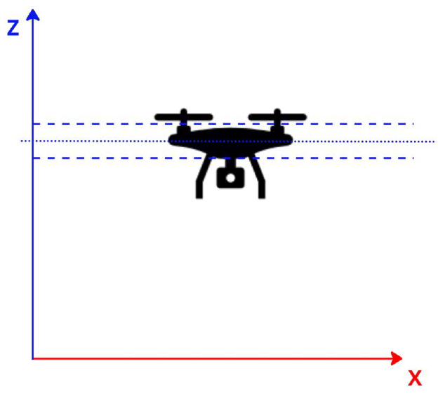

# Introdução ao Controle
O controle é uma disciplina fundamental da engenharia que lida com a gestão dinâmica dos sistemas para que eles se comportem de maneira desejada. A essência do controle está em monitorar e ajustar automaticamente a operação de sistemas, desde simples dispositivos mecânicos até complexas redes de comunicação e sistemas robóticos.

O princípio básico é regular as variáveis de um sistema mantendo-as próximas a um valor desejado ou setpoint. Isso é feita através do calculo do erro entre o valor desejado e o valor medido da variável controlada, e então aplicando ações corretivas para minimizar esse erro.

## Tipos de Controle
Existem dois tipos principais de controle: o controle em malha aberta e o controle em malha fechada:

1. Controle em Malha Aberta: Não há feedback do processo. As ações de controle são baseadas em um conjunto pré-definido de instruções que não se alteram em resposta ao estado atual do sistema. Um exemplo simples seria um forno elétrico programado para ficar ligado por um tempo determinado, independentemente da temperatura real dentro do forno.

2. Controle em Malha Fechada (ou Controle com Feedback): Usa o feedback do estado atual do sistema para tomar decisões de controle. Este tipo de controle é mais adaptativo e pode corrigir desvios em relação ao setpoint. Um exemplo seria adicionar um termostato ao forno elétrico para desligá-lo quando a temperatura desejada for atingida.

## Controle Proporcional (P)
Um dos métodos mais simples e amplamente utilizados no controle em malha fechada é o controle proporcional. Este método ajusta a saída do controlador de forma proporcional à diferença (erro) entre o valor desejado (setpoint) e o valor medido da variável controlada. O coeficiente que determina a relação entre o erro e a ação de controle é conhecido como ganho proporcional (K_p). Portanto uma ação de controle proporcional é dada pela seguinte equação:

```python
Ação de Controle = K_p * erro
```

Na esqueção acima, podemos ver que a ação de controle é proporcional ao erro. Se o erro for grande, a ação de controle será grande. Se o erro for pequeno, a ação de controle será pequena. Portanto no exemplo do forno elétrico, ao ligar o forno frio, o erro será grande e a ação de controle será grande, aumentando a potência do forno e elevando a temperatura rapidamente. À medida que a temperatura se aproxima do setpoint, o erro diminui reduzindo a potência do forno, evitando que a temperatura ultrapasse o setpoint drasticamente.

## Resposta da Ação de Controle
Outros conceitos importantes no controle são a resposta da ação de controle e o conceito de estabilidade. A resposta da ação de controle é a reação do sistema à ação de controle. Se a resposta for muito lenta, o sistema pode não atingir o setpoint ou pode crescer indefinidamente, levando o sistema a um estado instável. Se a resposta for muito rápida, o sistema pode ultrapassar o setpoint e oscilar em torno dele. Portanto, é importante ajustar o ganho proporcional para obter uma resposta rápida e estável.

# Exemplo de Controle Proporcional
A seguir, um simulador simples de controle proporcional. Um drone tenta manter uma altitude desejada (o **alvo**). A cada atualização, o controlador mede a altitude, calcula o **erro** (alvo − altitude) e pede ao drone uma velocidade de subida ou descida proporcional a esse erro. Aqui você pode ajustar o ganho proporcional (K_p) e ver como ele muda a **resposta** do drone.

A figura abaixo ilustra o sistema:



Em todo o simulador, **o controle P é o que está ligado por padrão**. É ele que você vai usar para centralizar um alvo na imagem (Segue Linha) e na APS 7.

## Exemplo: Controle Proporcional de Altitude em um Drone

<script src="https://cdn.plot.ly/plotly-2.35.2.min.js"></script>
<style>
.ctrlp { max-width: 760px; margin: 1em 0; font-family: sans-serif; line-height: 1.45; }
.ctrlp [hidden] { display: none !important; }
.ctrlp .ctrlp-campo { margin: 0 0 0.9em 0; }
.ctrlp .ctrlp-campo label { display: block; font-weight: bold; margin-bottom: 0.2em; }
.ctrlp .ctrlp-campo input[type="range"] { width: 100%; max-width: 340px; vertical-align: middle; }
.ctrlp .ctrlp-campo output { display: inline-block; min-width: 3.5em; margin-left: 0.5em; font-variant-numeric: tabular-nums; }
.ctrlp fieldset { margin: 1em 0; padding: 0.6em 0.9em; border: 1px solid #bbb; border-radius: 8px; }
.ctrlp legend { font-weight: bold; padding: 0 0.4em; }
.ctrlp .ctrlp-opcao { margin: 0 0 0.8em 0; }
.ctrlp .ctrlp-check { font-weight: bold; cursor: pointer; }
.ctrlp .ctrlp-check input { width: 1.1em; height: 1.1em; margin-right: 0.4em; vertical-align: middle; }
.ctrlp .ctrlp-dica { margin: 0.2em 0 0.5em 0; font-size: 0.95em; color: #333; }
.ctrlp details.ctrlp-mais { margin: 0.8em 0; padding: 0.4em 0.9em; border: 1px solid #ddd; border-radius: 8px; }
.ctrlp details.ctrlp-mais summary { cursor: pointer; font-weight: bold; }
.ctrlp .ctrlp-botoes { margin: 0.8em 0; }
.ctrlp button { font: inherit; padding: 0.4em 0.9em; border: 1px solid #666; border-radius: 6px; background: #f4f4f4; color: #111; cursor: pointer; }
.ctrlp button:hover { background: #e6e6e6; }
.ctrlp input:focus-visible, .ctrlp button:focus-visible, .ctrlp summary:focus-visible { outline: 3px solid #0b5fff; outline-offset: 2px; }
.ctrlp .ctrlp-status { padding: 0.8em 0.9em; margin: 0.8em 0; border-radius: 8px; border: 1px solid #bbb; background: #f3f3f3; color: #111; }
.ctrlp .ctrlp-status p { margin: 0 0 0.4em 0; }
.ctrlp .ctrlp-status ul { margin: 0.3em 0 0 1.2em; padding: 0; }
.ctrlp .ctrlp-tom-ok { background: #e3f4e6; border-color: #7bb88a; }
.ctrlp .ctrlp-tom-info { background: #e8f0fb; border-color: #8aa9d6; }
.ctrlp .ctrlp-tom-aviso { background: #fff4d6; border-color: #d6b24a; }
.ctrlp .ctrlp-tom-ruim { background: #fbe3e3; border-color: #d68a8a; }
.ctrlp .ctrlp-grafico { width: 100%; min-height: 320px; }
.ctrlp .ctrlp-grafico svg { width: 100%; height: auto; display: block; }
.ctrlp .ctrlp-aviso-grafico { font-size: 0.9em; color: #333; margin: 0.3em 0; }
@media (max-width: 600px) { .ctrlp .ctrlp-campo input[type="range"] { max-width: 100%; } }
</style>
<div class="ctrlp" id="ctrlp-raiz">
  <p>Mexa nos controles abaixo e observe três coisas no gráfico: o <b>alvo</b> (altitude desejada), a <b>resposta</b> (altitude real do drone) e o <b>erro</b> (alvo − altitude).</p>
  <div class="ctrlp-campo">
    <label for="ctrlp-kp">Kp (ganho proporcional)</label>
    <input type="range" id="ctrlp-kp" min="0" max="20" step="0.1" value="1">
    <output id="ctrlp-kp-val" for="ctrlp-kp">1,0</output>
  </div>
  <div class="ctrlp-campo">
    <label for="ctrlp-alvo">Alvo (altitude desejada, em m)</label>
    <input type="range" id="ctrlp-alvo" min="1" max="10" step="0.5" value="5">
    <output id="ctrlp-alvo-val" for="ctrlp-alvo">5,0 m</output>
  </div>
  <details class="ctrlp-mais">
    <summary>Mais opções do cenário</summary>
    <div class="ctrlp-campo">
      <label for="ctrlp-dt">dt (intervalo entre duas atualizações do controlador, em s)</label>
      <input type="range" id="ctrlp-dt" min="0.02" max="0.5" step="0.01" value="0.1">
      <output id="ctrlp-dt-val" for="ctrlp-dt">0,10 s</output>
    </div>
    <div class="ctrlp-campo">
      <label for="ctrlp-lim">Limite de velocidade do drone (em m/s)</label>
      <input type="range" id="ctrlp-lim" min="1" max="10" step="0.5" value="6">
      <output id="ctrlp-lim-val" for="ctrlp-lim">6,0 m/s</output>
    </div>
    <div class="ctrlp-campo">
      <label for="ctrlp-carga">Carga ou vento (puxa o drone para baixo, em m/s)</label>
      <input type="range" id="ctrlp-carga" min="0" max="1.5" step="0.1" value="0">
      <output id="ctrlp-carga-val" for="ctrlp-carga">0,0 m/s</output>
    </div>
  </details>
  <fieldset>
    <legend>Curiosidade (opcional)</legend>
    <p class="ctrlp-dica">Só o P é necessário para a aula e para a APS 7. Os termos I e D abaixo são apenas para quem quiser espiar como o controle pode ser refinado.</p>
    <div class="ctrlp-opcao">
      <label class="ctrlp-check"><input type="checkbox" id="ctrlp-usa-i" aria-describedby="ctrlp-dica-i">Ligar o termo integral (I)</label>
      <p class="ctrlp-dica" id="ctrlp-dica-i">O I vai somando o erro que sobra ao longo do tempo e empurra cada vez mais até o erro sumir. Teste junto com uma carga em ‘Mais opções’: só com P o erro sobra; com I ele pode zerar, às vezes com um ultrapasse.</p>
      <div class="ctrlp-campo" id="ctrlp-campo-ki" hidden>
        <label for="ctrlp-ki">Ki (ganho integral)</label>
        <input type="range" id="ctrlp-ki" min="0" max="2" step="0.05" value="0.3">
        <output id="ctrlp-ki-val" for="ctrlp-ki">0,30</output>
      </div>
    </div>
    <div class="ctrlp-opcao">
      <label class="ctrlp-check"><input type="checkbox" id="ctrlp-usa-d" aria-describedby="ctrlp-dica-d">Ligar o termo derivativo (D)</label>
      <p class="ctrlp-dica" id="ctrlp-dica-d">O D olha com que rapidez a altitude está mudando e segura o drone quando ele se aproxima depressa, como aliviar o acelerador antes de chegar. Não é um freio que sempre ajuda: com Kd muito alto o drone fica "travado" e demora para chegar.</p>
      <div class="ctrlp-campo" id="ctrlp-campo-kd" hidden>
        <label for="ctrlp-kd">Kd (ganho derivativo)</label>
        <input type="range" id="ctrlp-kd" min="0" max="3" step="0.05" value="0.5">
        <output id="ctrlp-kd-val" for="ctrlp-kd">0,50</output>
      </div>
    </div>
  </fieldset>
  <div class="ctrlp-botoes">
    <button type="button" id="ctrlp-reset">Restaurar valores iniciais (só P)</button>
  </div>
  <div class="ctrlp-status" id="ctrlp-status" role="status" aria-live="polite"></div>
  <div class="ctrlp-grafico" id="ctrlp-grafico" role="img" aria-label="Gráfico do alvo, da altitude do drone e do erro ao longo do tempo"></div>
</div>
<script>
(function () {
  "use strict";

  /* ---------- Modelo (didático) ----------
     Altitude y (m) e velocidade real v (m/s) do drone, comando u (m/s):
       y' = v - carga        (a carga/vento puxa o drone para baixo)
       v' = (u - v) / TAU    (inércia: a velocidade real demora ~TAU s para chegar em u)
     O controlador roda a cada dt e mantém u constante entre duas atualizações.
     Entre duas atualizações o drone é resolvido de forma EXATA (solução da equação
     acima com u constante), então o passo de desenho (0,02 s) não afeta a física:
     só a taxa dt do controlador pode desestabilizar o sistema.
     u = Kp*erro + Ki*(soma do erro) - Kd*(velocidade medida), limitado a +-limite.
     O D usa a medição (não o erro), então não dá "chute" quando o alvo muda.
     Anti-windup: o I só acumula quando o comando não está saturado ou quando o erro
     ajuda a sair da saturação; e o termo I é limitado ao limite de velocidade. */
  var TAU = 1.0;
  var DURACAO = 20;
  var PASSO_DESENHO = 0.02;
  var LIMITES = {
    kp: [0, 20], ki: [0, 2], kd: [0, 3], alvo: [1, 10],
    dt: [0.02, 0.5], lim: [1, 10], carga: [0, 1.5]
  };
  var PADRAO = {
    kp: 1, ki: 0.3, kd: 0.5, alvo: 5, dt: 0.1, lim: 6, carga: 0,
    usaI: false, usaD: false
  };

  function sanitizar(entrada) {
    var e = entrada || {};
    var p = { usaI: e.usaI === true, usaD: e.usaD === true };
    Object.keys(LIMITES).forEach(function (k) {
      var v = Number(e[k]);
      if (!isFinite(v)) { v = PADRAO[k]; }
      p[k] = Math.min(LIMITES[k][1], Math.max(LIMITES[k][0], v));
    });
    return p;
  }

  function simular(entrada) {
    var p = sanitizar(entrada);
    var kp = p.kp;
    var ki = p.usaI ? p.ki : 0;
    var kd = p.usaD ? p.kd : 0;
    var dt = p.dt;
    var n = Math.max(1, Math.ceil(dt / PASSO_DESENHO - 1e-9));
    var h = dt / n;
    var a = Math.exp(-h / TAU);
    var passos = Math.round(DURACAO / dt);
    var y = 0, v = 0, soma = 0, yAnterior = 0, saturados = 0;
    var t = [], alt = [], erro = [], cmd = [];
    for (var k = 0; k < passos; k++) {
      var e = p.alvo - y;
      var termoD = (k === 0) ? 0 : -kd * (y - yAnterior) / dt;
      yAnterior = y;
      var bruto = kp * e + ki * soma + termoD;
      var u = Math.min(p.lim, Math.max(-p.lim, bruto));
      var saturou = (u !== bruto);
      if (saturou) { saturados++; }
      if (ki > 0) {
        if (!saturou || (bruto > p.lim && e < 0) || (bruto < -p.lim && e > 0)) { soma += e * dt; }
        soma = Math.min(p.lim / ki, Math.max(-p.lim / ki, soma));
      }
      if (k === 0) { t.push(0); alt.push(y); erro.push(e); cmd.push(u); }
      for (var j = 0; j < n; j++) {
        y = y + (u - p.carga) * h + (v - u) * TAU * (1 - a);
        v = u + (v - u) * a;
        if (y < 0) { y = 0; if (v < 0) { v = 0; } }
        t.push((k * n + j + 1) * h);
        alt.push(y);
        erro.push(p.alvo - y);
        cmd.push(u);
      }
    }
    var valido = [t, alt, erro, cmd].every(function (s) { return s.every(isFinite); });
    return {
      params: p, t: t, alt: alt, erro: erro, cmd: cmd,
      fracSaturada: passos > 0 ? saturados / passos : 0, valido: valido
    };
  }

  /* Conta quantas vezes a curva inverte de sentido com amplitude maior que "folga". */
  function reversoes(ys, folga) {
    var dir = 0, topo = ys[0], fundo = ys[0], cont = 0;
    for (var i = 0; i < ys.length; i++) {
      var y = ys[i];
      if (y > topo) { topo = y; }
      if (y < fundo) { fundo = y; }
      if (dir <= 0 && y - fundo > folga) { if (dir < 0) { cont++; } dir = 1; topo = y; }
      else if (dir >= 0 && topo - y > folga) { if (dir > 0) { cont++; } dir = -1; fundo = y; }
    }
    return cont;
  }

  function analisar(res) {
    var p = res.params;
    var tol = 0.05 * p.alvo;
    var n = res.alt.length;
    var maxAlt = Math.max.apply(null, res.alt);
    var ultrapasse = Math.max(0, maxAlt - p.alvo);
    var erroFinal = res.erro[n - 1];
    var tChegada = null;
    var tAssentou = null;
    var ultimoFora = -1;
    for (var i = 0; i < n; i++) {
      if (tChegada === null && res.alt[i] >= p.alvo - tol) { tChegada = res.t[i]; }
      if (Math.abs(res.erro[i]) > tol) { ultimoFora = i; }
    }
    if (ultimoFora < n - 1) { tAssentou = ultimoFora < 0 ? 0 : res.t[ultimoFora + 1]; }
    var cauda = [];
    for (var q = 0; q < n; q++) { if (res.t[q] >= 0.75 * DURACAO) { cauda.push(res.alt[q]); } }
    var oscila = reversoes(cauda, tol) >= 2;
    var m = {
      alvo: p.alvo, ultrapasse: ultrapasse, ultrapassePct: 100 * ultrapasse / p.alvo,
      erroFinal: erroFinal, tChegada: tChegada, tAssentou: tAssentou,
      oscila: oscila, fracSaturada: res.fracSaturada
    };
    var kiAtivo = p.usaI && p.ki > 0;
    var r;
    if (!res.valido) {
      r = { id: "invalido", tom: "ruim", nome: "Resultado inválido", texto: "A simulação gerou valores inválidos. Restaure os valores iniciais." };
    } else if (p.kp === 0 && !kiAtivo) {
      r = { id: "parado", tom: "info", nome: "Sem controle (Kp = 0)",
        texto: "Com Kp = 0 o comando é sempre zero: o controlador não reage ao erro e o drone não sobe." };
    } else if (oscila) {
      r = { id: "oscila", tom: "ruim", nome: "Oscilação que não some",
        texto: "No fim dos " + DURACAO + " s o drone ainda sobe e desce em torno do alvo. Isso indica instabilidade (ou uma oscilação lenta demais para sumir). O limite de velocidade só impede a altitude de crescer sem parar; ele não deixa o sistema estável. Tente diminuir Kp ou usar um dt menor." };
    } else if (Math.abs(erroFinal) <= tol) {
      if (m.ultrapassePct > 10) {
        r = { id: "ultrapassa", tom: "aviso", nome: "Chega ao alvo, mas passa dele",
          texto: "O drone ultrapassa o alvo em " + fmt(m.ultrapassePct, 0) + "% e depois volta. Nesse momento o erro fica negativo e o comando manda descer." };
      } else if (tAssentou > 10) {
        r = { id: "lento-chega", tom: "aviso", nome: "Chega ao alvo, mas devagar",
          texto: "O drone chega perto do alvo, mas leva mais de 10 s. Um Kp maior deixa a resposta mais rápida." };
      } else {
        r = { id: "boa", tom: "ok", nome: "Boa resposta",
          texto: "O drone chega perto do alvo (dentro de 5%) e fica ali, com pouco ou nenhum ultrapasse." };
      }
    } else if (erroFinal > 0 && p.carga > 0 && !kiAtivo) {
      r = { id: "erro-permanente", tom: "aviso", nome: "Sobra um erro",
        texto: "A carga puxa o drone para baixo. Com só P, o comando é zero quando o erro é zero, então o drone se acomoda um pouco abaixo do alvo (quanto maior o Kp, menor o erro que sobra)." };
    } else if (erroFinal > 0) {
      r = { id: "lento", tom: "aviso", nome: "Resposta lenta",
        texto: "Depois de " + DURACAO + " s o drone ainda não chegou perto do alvo. Aumentar Kp deixa a resposta mais rápida." };
    } else {
      r = { id: "acima", tom: "aviso", nome: "Passou do alvo e ainda não voltou",
        texto: "O drone terminou acima do alvo (erro negativo) e ainda está descendo." };
    }
    r.metricas = m;
    return r;
  }

  function fmt(x, casas) { return Number(x).toFixed(casas).replace(".", ","); }

  /* ---------- Interface ---------- */
  var raiz = (typeof document !== "undefined") ? document.getElementById("ctrlp-raiz") : null;
  if (raiz) {
    var $ = function (id) { return document.getElementById("ctrlp-" + id); };
    var usarFallback = false;

    var ler = function () {
      return {
        kp: parseFloat($("kp").value), alvo: parseFloat($("alvo").value),
        dt: parseFloat($("dt").value), lim: parseFloat($("lim").value),
        carga: parseFloat($("carga").value),
        ki: parseFloat($("ki").value), kd: parseFloat($("kd").value),
        usaI: $("usa-i").checked, usaD: $("usa-d").checked
      };
    };

    var atualizarSaidas = function (p) {
      $("kp-val").textContent = fmt(p.kp, 1);
      $("alvo-val").textContent = fmt(p.alvo, 1) + " m";
      $("dt-val").textContent = fmt(p.dt, 2) + " s";
      $("lim-val").textContent = fmt(p.lim, 1) + " m/s";
      $("carga-val").textContent = fmt(p.carga, 1) + " m/s";
      $("ki-val").textContent = fmt(p.ki, 2);
      $("kd-val").textContent = fmt(p.kd, 2);
      $("campo-ki").hidden = !p.usaI;
      $("campo-kd").hidden = !p.usaD;
    };

    var escreverStatus = function (r, p) {
      var m = r.metricas;
      var termos = "P" + (p.usaI ? " + I" : "") + (p.usaD ? " + D" : "");
      var itens = [];
      itens.push("Controle ligado: <b>" + termos + "</b>");
      itens.push("Ultrapasse máximo: <b>" + fmt(m.ultrapasse, 2) + " m</b> (" + fmt(m.ultrapassePct, 0) + "% do alvo)");
      itens.push("Erro no fim da simulação: <b>" + fmt(m.erroFinal, 2) + " m</b>");
      itens.push("Chega perto do alvo (±5%) em: <b>" + (m.tChegada === null ? "não chega" : fmt(m.tChegada, 1) + " s") + "</b>");
      itens.push("Comando no limite de velocidade em: <b>" + fmt(100 * m.fracSaturada, 0) + "%</b> das atualizações");
      var extra = "";
      if (m.fracSaturada > 0.2 && r.id !== "parado") {
        extra = "<p>O comando ficou no limite de velocidade boa parte do tempo: nessa fase, aumentar Kp não faz o drone subir mais rápido.</p>";
      }
      var el = $("status");
      el.className = "ctrlp-status ctrlp-tom-" + r.tom;
      el.innerHTML = "<p><b>" + r.nome + ".</b> " + r.texto + "</p>" + extra +
        "<ul><li>" + itens.join("</li><li>") + "</li></ul>";
    };

    var ticks = function (v0, v1, qtd) {
      var out = [];
      for (var i = 0; i <= qtd; i++) { out.push(v0 + (v1 - v0) * i / qtd); }
      return out;
    };

    /* Gráfico simples em SVG, usado quando o Plotly não carrega ou dá erro. */
    var svgGrafico = function (res) {
      var p = res.params;
      var W = 720, H = 440, ml = 56, mr = 14;
      var xs = function (t) { return ml + (W - ml - mr) * t / DURACAO; };
      var maxA = Math.max(p.alvo, Math.max.apply(null, res.alt));
      var minA = Math.min(0, Math.min.apply(null, res.alt));
      var topoA = maxA + 0.1 * (maxA - minA) + 0.2;
      var maxE = Math.max(0.5, Math.max.apply(null, res.erro));
      var minE = Math.min(-0.5, Math.min.apply(null, res.erro));
      var pa = { y0: 34, h: 250, v0: minA, v1: topoA };
      var pe = { y0: 330, h: 70, v0: minE, v1: maxE };
      var ys = function (pn, v) { return pn.y0 + pn.h * (1 - (v - pn.v0) / (pn.v1 - pn.v0)); };
      var linha = function (pn, vals, cor, largura, tracejado) {
        var pts = vals.map(function (v, i) { return xs(res.t[i]).toFixed(1) + "," + ys(pn, v).toFixed(1); });
        return '<polyline fill="none" stroke="' + cor + '" stroke-width="' + largura + '"' +
          (tracejado ? ' stroke-dasharray="6 4"' : "") + ' points="' + pts.join(" ") + '"/>';
      };
      var eixos = function (pn, rotulo) {
        var s = '<rect x="' + ml + '" y="' + pn.y0 + '" width="' + (W - ml - mr) + '" height="' + pn.h + '" fill="none" stroke="#888"/>';
        ticks(pn.v0, pn.v1, 4).forEach(function (v) {
          s += '<text x="' + (ml - 6) + '" y="' + (ys(pn, v) + 4).toFixed(1) + '" text-anchor="end" font-size="11">' + fmt(v, 1) + "</text>";
        });
        s += '<text x="12" y="' + (pn.y0 + pn.h / 2) + '" font-size="12" text-anchor="middle" transform="rotate(-90 12 ' + (pn.y0 + pn.h / 2) + ')">' + rotulo + "</text>";
        return s;
      };
      var s = '<svg viewBox="0 0 ' + W + " " + H + '" role="img" aria-labelledby="ctrlp-svg-t ctrlp-svg-d" xmlns="http://www.w3.org/2000/svg" font-family="sans-serif">';
      s += '<title id="ctrlp-svg-t">Gráfico simplificado: alvo, altitude e erro</title>';
      s += '<desc id="ctrlp-svg-d">Alvo de ' + fmt(p.alvo, 1) + ' m. A linha azul é a altitude do drone, a tracejada é o alvo e, no gráfico de baixo, a laranja é o erro (alvo menos altitude).</desc>';
      s += '<rect width="' + W + '" height="' + H + '" fill="#fff"/>';
      s += eixos(pa, "Altitude (m)") + eixos(pe, "Erro (m)");
      s += '<line x1="' + ml + '" x2="' + (W - mr) + '" y1="' + ys(pe, 0).toFixed(1) + '" y2="' + ys(pe, 0).toFixed(1) + '" stroke="#888" stroke-dasharray="2 3"/>';
      s += '<line x1="' + xs(0) + '" x2="' + xs(DURACAO) + '" y1="' + ys(pa, p.alvo).toFixed(1) + '" y2="' + ys(pa, p.alvo).toFixed(1) + '" stroke="#444" stroke-width="2" stroke-dasharray="6 4"/>';
      s += linha(pa, res.alt, "#0072B2", 3, false);
      s += linha(pe, res.erro, "#D55E00", 2, false);
      ticks(0, DURACAO, 5).forEach(function (tt) {
        s += '<text x="' + xs(tt).toFixed(1) + '" y="' + (pe.y0 + pe.h + 16) + '" text-anchor="middle" font-size="11">' + fmt(tt, 0) + "</text>";
      });
      s += '<text x="' + (ml + (W - ml - mr) / 2) + '" y="' + (H - 6) + '" text-anchor="middle" font-size="12">Tempo (s)</text>';
      s += '<line x1="' + ml + '" x2="' + (ml + 24) + '" y1="14" y2="14" stroke="#444" stroke-width="2" stroke-dasharray="6 4"/><text x="' + (ml + 30) + '" y="18" font-size="12">Alvo (altitude desejada)</text>';
      s += '<line x1="' + (ml + 200) + '" x2="' + (ml + 224) + '" y1="14" y2="14" stroke="#0072B2" stroke-width="3"/><text x="' + (ml + 230) + '" y="18" font-size="12">Resposta (altitude do drone)</text>';
      s += '<line x1="' + (ml + 430) + '" x2="' + (ml + 454) + '" y1="14" y2="14" stroke="#D55E00" stroke-width="2"/><text x="' + (ml + 460) + '" y="18" font-size="12">Erro = alvo − altitude</text>';
      return s + "</svg>";
    };

    var desenharFallback = function (res, motivo) {
      usarFallback = true;
      var alvoEl = $("grafico");
      if (typeof Plotly !== "undefined" && Plotly.purge) { try { Plotly.purge(alvoEl); } catch (e) { /* sem efeito */ } }
      alvoEl.innerHTML = '<p class="ctrlp-aviso-grafico"><b>Gráfico simplificado:</b> ' + motivo + "</p>" + svgGrafico(res);
    };

    var desenharPlotly = function (res) {
      var p = res.params;
      var dados = [
        { x: [0, DURACAO], y: [p.alvo, p.alvo], mode: "lines", name: "Alvo (altitude desejada)", line: { color: "#444444", dash: "dash", width: 2 } },
        { x: res.t, y: res.alt, mode: "lines", name: "Resposta (altitude do drone)", line: { color: "#0072B2", width: 3 } },
        { x: res.t, y: res.erro, mode: "lines", name: "Erro = alvo − altitude", yaxis: "y2", line: { color: "#D55E00", width: 2 } }
      ];
      var layout = {
        height: 480,
        xaxis: { title: "Tempo (s)", anchor: "y2", range: [0, DURACAO] },
        yaxis: { title: "Altitude (m)", domain: [0.36, 1], zeroline: true },
        yaxis2: { title: "Erro (m)", domain: [0, 0.27], zeroline: true },
        legend: { orientation: "h", x: 0, y: 1.12 },
        margin: { t: 50, r: 20, l: 60, b: 50 }
      };
      var promessa = Plotly.react("ctrlp-grafico", dados, layout, { responsive: true, displayModeBar: false });
      if (promessa && promessa.catch) {
        promessa.catch(function () {
          desenharFallback(res, "o gráfico interativo (Plotly) falhou ao desenhar.");
        });
      }
    };

    var atualizar = function () {
      var p = ler();
      atualizarSaidas(p);
      var res = simular(p);
      var r = analisar(res);
      escreverStatus(r, res.params);
      $("grafico").setAttribute("aria-label",
        "Gráfico do alvo, da altitude do drone e do erro ao longo do tempo. " + r.nome + ".");
      if (!usarFallback && typeof Plotly !== "undefined") {
        try { desenharPlotly(res); } catch (e) {
          desenharFallback(res, "o gráfico interativo (Plotly) falhou ao desenhar.");
        }
      } else {
        desenharFallback(res, "a biblioteca de gráficos (Plotly) não carregou; os números acima continuam valendo.");
      }
    };

    var restaurar = function () {
      ["kp", "alvo", "dt", "lim", "carga", "ki", "kd"].forEach(function (k) { $(k).value = PADRAO[k]; });
      $("usa-i").checked = false;
      $("usa-d").checked = false;
      atualizar();
    };

    raiz.addEventListener("input", atualizar);
    raiz.addEventListener("change", atualizar);
    $("reset").addEventListener("click", restaurar);
    atualizar();
  }

  if (typeof window !== "undefined") {
    window.RobcompControleP = { simular: simular, analisar: analisar, PADRAO: PADRAO, LIMITES: LIMITES, TAU: TAU, DURACAO: DURACAO };
  }
})();
</script>

Observe que aumentar Kp nem sempre melhora o controle. Um ganho proporcional muito baixo faz o drone subir lentamente. Um ganho muito alto faz o drone reagir de maneira agressiva, podendo ultrapassar a altitude desejada e oscilar. Além disso, quanto maior o intervalo de atualização do controlador, mais "atrasada" fica a reação do sistema, o que também pode aumentar as oscilações.

### O que este simulador simplifica
- O drone só sobe e desce (uma dimensão), sem ruído de sensor e com um chão em 0 m.
- O controlador pede uma **velocidade**. O drone leva cerca de 1 s para alcançá-la (inércia). Por isso ele pode passar do alvo e oscilar, como um drone de verdade. Isto é diferente da versão antiga do simulador, em que o drone obedecia instantaneamente.
- A carga (ou vento) é uma velocidade constante para baixo, usada só para mostrar o que sobra de erro com P.
- O comando tem um limite de velocidade. Quando o comando bate nesse limite, o gráfico pode parecer "comportado", mas isso **não** significa que o controle está estável. Olhe a mensagem de resultado e o erro no fim.

!!! warning "Atenção"
    Os números do simulador (alvo, Kp, limite de velocidade) valem só para este drone de mentirinha. No robô real, comece com ganhos pequenos e respeite os limites de velocidade da atividade (por exemplo, ±0,5 rad/s na velocidade angular do [Segue Linha](2-segue-linha.md)).

## Perguntas para explorar
Tente responder antes de abrir o comentário. Não existe resposta única: o que vale é observar o gráfico.

??? dica "1. Com Kp = 0,2 a resposta fica lenta. O que você mudaria?"
    Aumentar o Kp. Como o comando é Kp vezes o erro, um Kp pequeno dá um comando pequeno, principalmente quando o erro já é pequeno. Teste Kp = 0,5 e Kp = 1 e compare o tempo para chegar perto do alvo.

??? dica "2. Coloque Kp = 15 e, em ‘Mais opções’, dt = 0,3. O que aparece no gráfico? O que fazer?"
    O drone passa do alvo, volta, passa de novo e continua oscilando. Diminuir o Kp ou usar um dt menor acalma a resposta. Um Kp maior nem sempre é melhor.

??? dica "3. O que acontece com Kp = 0?"
    O comando fica sempre zero, não importa o erro: o drone não reage e o erro continua do tamanho do alvo. Sem reagir ao erro, não existe controle.

??? dica "4. Com Kp = 5, compare alvo = 2 m com alvo = 10 m. Depois reduza o limite de velocidade para 2 m/s. O que muda?"
    Com alvo maior o erro inicial é maior, então o comando pedido também é maior e pode bater no limite de velocidade. Enquanto o comando está no limite, o drone sobe na velocidade máxima e aumentar Kp não ajuda. Robôs reais também têm limites, por isso a gente limita o comando.

??? dica "5. Com Kp = 2, olhe o gráfico do erro. Quando ele fica negativo e o que o drone faz nesse momento?"
    O erro é alvo menos altitude. Quando o drone passa do alvo, o erro fica negativo, o comando fica negativo e o drone desce. O sinal do erro diz para que lado corrigir. Pense nisso no [Segue Linha](2-segue-linha.md): de que lado do centro da imagem a linha está, e para que lado o robô precisa girar?
