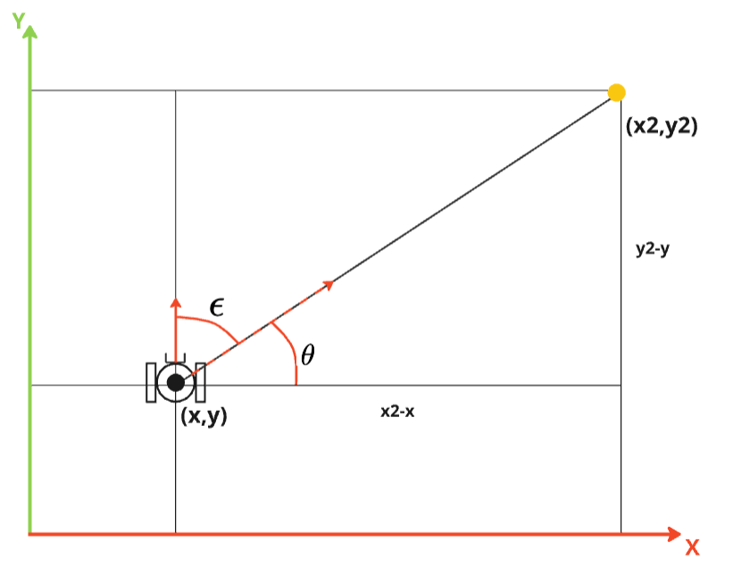

# GoTo (vai até coordenadas)

Quando o robô está em um ambiente conhecido, é possível fazer com que ele vá até uma coordenada específica. Para isso, é necessário que o robô saiba a sua posição e a posição desejada. Nesta atividade, você irá criar um nó que faz o robô ir até uma coordenada específica.

## Geometria

Considere que o robô está em um plano cartesiano e que a posição do robô é dada por `(x, y)` e a posição desejada é dada por `(x2, y2)`.

Para fazer o robô ir até a posição desejada, devemos "mirar" o robô em direção ao ponto desejado e então fazer o robô se mover até o ponto. Para isso, devemos calcular o erro angular entre o `yaw` atual do robô e o ângulo `theta` formado entre o robô e o ponto desejado.

A distância entre o robô e o ponto desejado pode ser utilizado para controlar a velocidade do robô. Quanto mais perto do ponto, menor a velocidade.

## Comportamento

O robô deve primeiro girar até se alinhar com o ponto desejado e então iniciar o deslocamento. A ação utiliza os estados `center`, `goto`, `stop` e `done`, seguindo o modelo de ação do capítulo 3.

* A ação começa em `done`, aguardando uma chamada a `reset(point)`. Essa chamada inicia o estado `center`, que faz o robô girar até se alinhar com o ponto desejado.
* O estado `goto` deve utilizar controladores proporcionais para mover o robô até o ponto desejado (`kp_linear`) e ajustar a sua orientação (`kp_angular`).
* Ao atingir a tolerância de distância, o robô entra em `stop`, publica velocidade zero, encerra o timer e passa para `done`.

## Prática 1: Ação GoTo

Baseando-se no [Nó Base de Ação](../../03-laser-e-robo/util/base_action.py) do capítulo 3, crie o arquivo `goto.py`, com a classe `GoTo` e o nó `goto_node`, para levar o robô real até uma coordenada.

1. A classe deve herdar de `Node` e `Odom`, inicializando ambas as classes.
2. Comece em `done` e mantenha os estados `center`, `goto`, `stop` e `done` na máquina de estados.
3. Implemente `reset(point)`, recebendo um `geometry_msgs.msg.Point`. Salve o destino, zere o comando de velocidade e inicie o estado `center` e o timer de controle, conforme o modelo do capítulo 3.
4. Antes de movimentar o robô, aguarde o recebimento da odometria, incluindo a orientação `yaw`.
5. Implemente `get_angular_error` para calcular o ângulo até o destino com `atan2(y_destino - y, x_destino - x)` e o erro em relação ao `yaw` atual. Normalize esse erro para o intervalo `[-pi, pi]`.
6. Calcule também a distância até o destino. No estado `center`, mantenha a velocidade linear zero e gire até atingir uma tolerância angular definida pelo grupo.
7. No estado `goto`, use `kp_linear` para controlar a aproximação e `kp_angular` para corrigir a orientação. Limite as velocidades e pare ao atingir uma tolerância de distância definida pelo grupo.
8. Em `stop`, zere a velocidade, encerre o timer e passe para `done`. Uma nova chamada a `reset(point)` deve permitir executar outro destino.

As coordenadas do destino devem usar o mesmo referencial da posição medida. Nesta atividade, use o frame `odom`; a posição global no frame `map` será discutida na atividade de SLAM. O `GoTo` controla o deslocamento até um ponto, mas não planeja desvios de obstáculos: teste inicialmente em uma região livre.

## Verificação

Teste destinos à frente, ao lado e atrás do robô. Verifique se ele alinha, se aproxima e para antes de enviar o próximo destino. Esse comportamento será reutilizado para percorrer os vértices do quadrado na APS 8.
