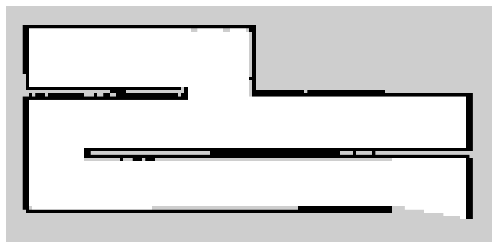
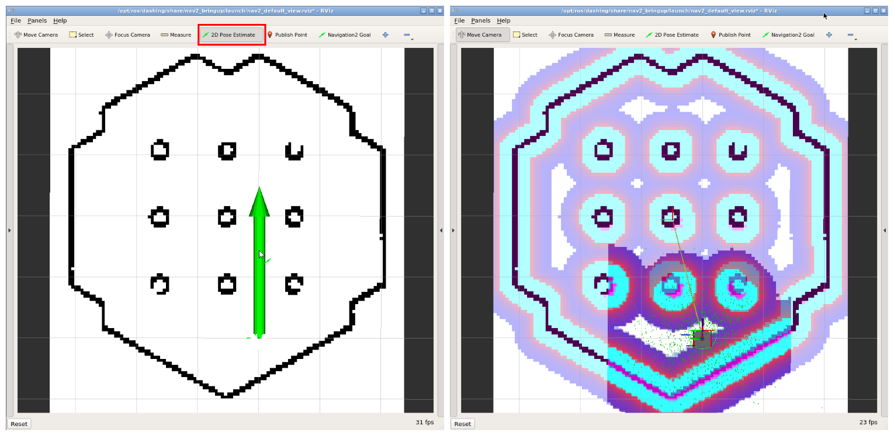

# ROS2 SLAM

Referência: [ROS2 SLAM](https://emanual.robotis.com/docs/en/platform/turtlebot3/slam/#run-slam-node)


SLAM (Simultaneous Localization and Mapping) ou Mapeamento e Localização Simultâneos é uma técnica usada por robôs e veículos autônomos para construir um mapa do ambiente e, ao mesmo tempo, localizar sua posição nesse ambiente. A ROS2 oferece uma série de pacotes que permitem a execução de algoritmos de SLAM no Turtlebot3.

Veja o vídeo abaixo de demonstração do SLAM no Turtlebot3:

[Turtlebot3 SLAM](https://www.youtube.com/watch?v=pJNSxDodhDk)

## Preparação

Antes de começar, siga a [checagem da infraestrutura](../../01-intro/atividades/guias-infra/checagem.md) e mantenha os nós de sensores e odometria do robô em execução. Você precisará dos pacotes `turtlebot3_cartographer`, `turtlebot3_navigation2` e `nav2_map_server`.

**Os comandos abaixo usam o robô real, com `use_sim_time:=False`.** Para testar no Gazebo, use `use_sim_time:=True` em todos os nós envolvidos. Não misture os dois relógios na mesma execução.

## Executando o Mapeamento

Para iniciar o mapeamento do ambiente, devemos executar o pacote denominado `Cartographer`. Para isso, execute os comandos abaixo:

```bash
ros2 launch turtlebot3_cartographer cartographer.launch.py use_sim_time:=False
```

Agora, abra um novo terminal com o `teleop` para controlar o Turtlebot3:

```bash
ros2 run turtlebot3_teleop teleop_keyboard
```

Com o `teleop` aberto, movimente o Turtlebot3 pelo ambiente para que o mapeamento seja realizado. Após finalizar o mapeamento, execute o comando abaixo para salvar o mapa:

```bash
ros2 run nav2_map_server map_saver_cli -f ~/map --ros-args -p use_sim_time:=False
```

Os arquivos serão salvos como `~/map.pgm` e `~/map.yaml`. O YAML informa, entre outros parâmetros, a resolução em metros por célula e a origem do mapa. Guarde os dois arquivos juntos.

## Visualizando o Mapa

O mapa será salvo como um arquivo de imagem no formato `pgm`. Como no exemplo abaixo:



O mapa ilustra o ambiente mapeado, onde os pixels pretos representam obstáculos, os pixels brancos representam áreas livres e os pixels cinzas representam áreas desconhecidas.

## Navegando no Mapa

Para navegar em um mapa salvo, encerre a teleoperação e o Cartographer, mas mantenha os nós do robô e de seus sensores em execução. Inicie o Nav2 com o mapa salvo:

```bash
ros2 launch turtlebot3_navigation2 navigation2.launch.py use_sim_time:=False map:=$HOME/map.yaml
```

Uma vez que o pacote de navegação esteja em execução, vamos primeiro definir a posição inicial do Turtlebot3 no mapa, para isso, clique no botão `2D Pose Estimate` no Rviz e clique e segure o botão esquerdo do mouse no local onde o Turtlebot3 está localizado no mapa. Em seguida, arraste o mouse para a direção que o Turtlebot3 está apontando e solte o botão esquerdo do mouse, conforme ilustrado na imagem abaixo:




## Definindo o Ponto de Destino da Navegação

Agora, para definir o ponto de destino da navegação, clique no botão `2D Nav Goal` no Rviz e clique e segure o botão esquerdo do mouse no local onde deseja que o Turtlebot3 vá. Em seguida, arraste o mouse para a direção que deseja que o Turtlebot3 esteja apontando e solte o botão esquerdo do mouse.

## Navegação enquanto o mapa é construído

No labirinto desconhecido do projeto, o Cartographer deve continuar em execução para atualizar o mapa e a localização. Seu programa pode ler o tópico `/map` (`nav_msgs/msg/OccupancyGrid`), escolher destinos e conduzir o robô usando essa informação.

Para combinar o Cartographer com o Nav2 na infraestrutura da disciplina, execute os comandos abaixo, cada um em um terminal diferente:

```bash
ros2 launch turtlebot3_cartographer cartographer.launch.py use_sim_time:=False
ros2 launch turtlebot3_navigation2 navigation2.launch.py use_sim_time:=False \
map:='topic://map'
```

Na APS 8, o mapeamento pode ser feito somente com Cartographer e teleoperação. A escolha autônoma dos destinos de exploração será necessária no projeto.

### Extraindo a posição do robô no mapa

Quando usamos o sistema de navegação, o tópico `/odom` sozinho não é suficiente para obter a posição do robô no mapa. Isso acontece porque `/odom` representa a pose do robô em um sistema de coordenadas local, associado ao frame `odom`.

Para obter a posição global do robô no mapa, precisamos combinar a odometria com as transformações publicadas no tópico `/tf`. Em especial, usamos a transformação entre os frames `map` e `odom`, junto com a pose do robô em relação ao frame `odom`.

De forma simplificada, a composição é:

```text
map -> odom -> base_link
```

Assim, conseguimos estimar a pose do robô no frame `map`, ou seja:

```text
x, y, yaw no mapa
```

O arquivo didático [`amcl.py`](../util/amcl.py) compõe a transformação `map -> odom` com a odometria para publicar essa pose. Apesar do nome da classe `AMCL`, ele **não implementa o algoritmo de localização AMCL**: é um nó auxiliar de leitura da pose.

Ao navegar com um mapa salvo, o AMCL do Nav2 já publica `/amcl_pose`; nesse caso, use esse tópico diretamente e não execute o auxiliar no mesmo tópico.

Durante o SLAM, se precisar do auxiliar, execute-o como um nó independente, remapeando a publicação para evitar confusão com o AMCL do Nav2:

```bash
python3 amcl.py --ros-args -r /amcl_pose:=/map_pose -p use_sim_time:=False
```

Baixe o arquivo e execute o comando na pasta em que ele foi salvo. Configure seu subscriber para `/map_pose`. O publisher do auxiliar é `VOLATILE`; o subscriber também deve usar durabilidade `VOLATILE`. Diferentemente da classe `Odom`, esse auxiliar não deve ser usado como uma classe de herança do controlador. A covariância publicada pelo auxiliar contém valores fixos de exemplo, não uma estimativa de incerteza.

Os tópicos `/amcl_pose` (AMCL do Nav2) e `/map_pose` (auxiliar remapeado) usam o tipo:

```text
geometry_msgs/msg/PoseWithCovarianceStamped
```

Nessas mensagens:

- `pose.pose.position.x` representa a posição do robô no eixo X do mapa (metros);
- `pose.pose.position.y` representa a posição do robô no eixo Y do mapa (metros);
- `pose.pose.orientation` representa a orientação do robô no mapa.

## Da atividade ao projeto

Para trabalhar com o mapa no código, observe a resolução, a origem e as dimensões de `OccupancyGrid`. Os valores indicam células desconhecidas (`-1`) ou ocupação de `0` a `100`. A representação como imagem também exige atenção ao sentido do eixo vertical.

No projeto, além de mapear, será necessário escolher destinos de exploração, planejar por regiões conhecidas e livres e manter distância das paredes. O relatório deverá explicar os métodos escolhidos e como os comportamentos de navegação, visão e garra foram integrados.
