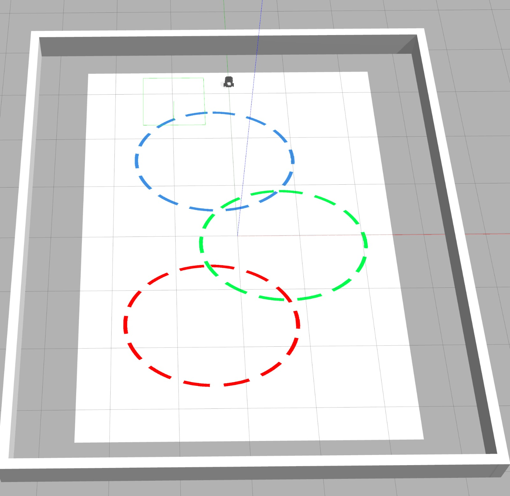
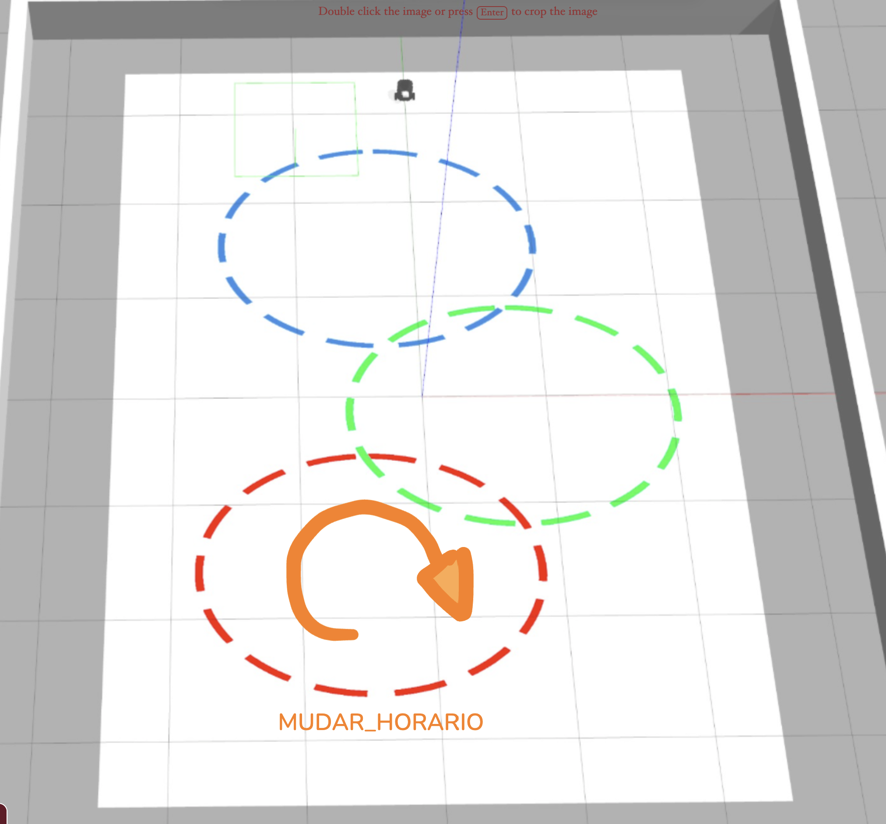
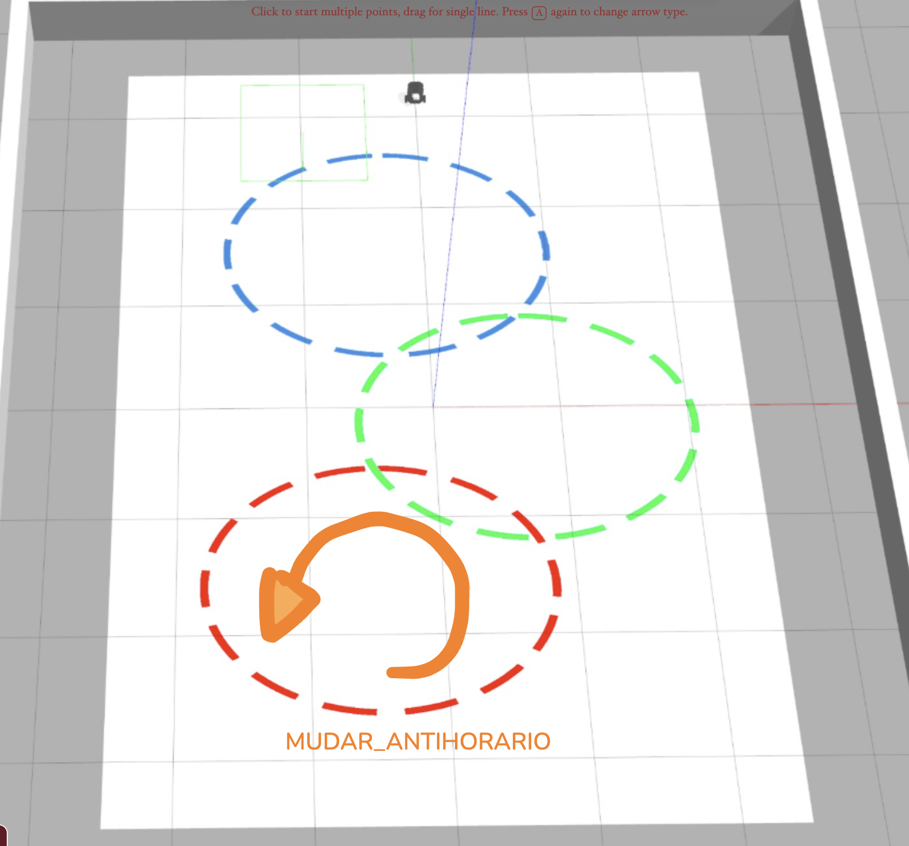
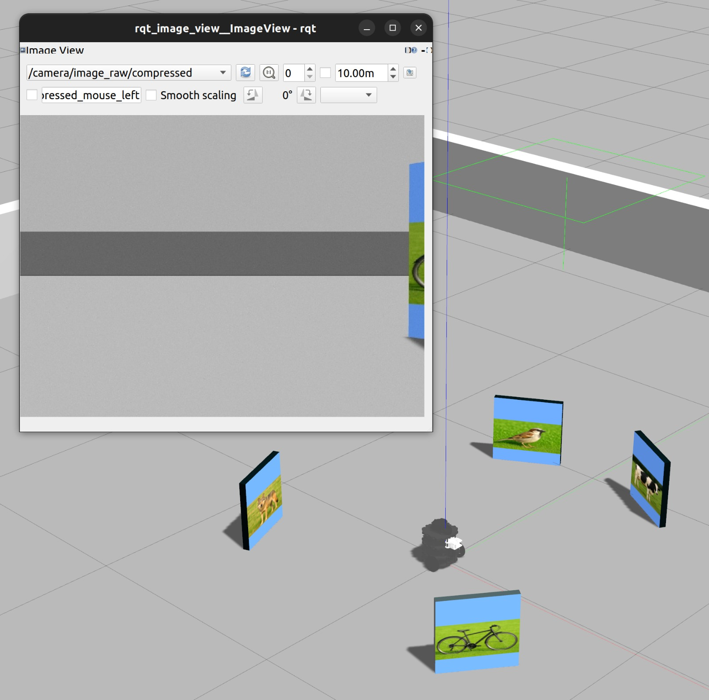

# Robótica Computacional - Simulado AF 3

## Atualização do Pacote (ROS 2)

Execute os comandos abaixo para atualizar os pacotes da `ros2` obrigatórios para a prova:

```bash
cd ~/colcon_ws/src/my_simulation
git stash
git pull
cb
```

## Configuração do Pacote (ROS 2)

- **Preparação Inicial:** O repositório é informado no Blackboard (veja [Sobre as APS](https://insper.github.io/robotica-computacional/aps/)). Clone-o **dentro da pasta** `colcon_ws/src/` no seu SSD.
- **Criação do Pacote ROS 2:** **Dentro do diretório do seu repositório**, crie um novo pacote chamado `simulado_3`.

    - **Dica:** Para utilizar os módulos desenvolvidos no capitulo 3, inclua o pacote `robcomp_util` e o pacote `robcomp_interfaces` como dependência do seu pacote, e então, importe como nos exemplos do capitulo 3.

---

# Exercício 0 - Organização & Qualidade
Este exercício avalia a organização e a qualidade dos vídeos dos exercícios e do arquivo `README.md`.

## Critérios de Avaliação:
* O pacote foi corretamente configurado.
* As dependências do pacote estão corretas.
* Os diretórios e arquivos estão organizados de forma adequada.
* Todos os scripts estão na pasta `simulado_3` dentro do pacote `simulado_3`.
* A configuração dos nós foi realizada corretamente.
* Os nós da ROS 2 foram executados utilizando o comando `ros2 run`.
* **Vídeo:** A ação do robô é claramente compreensível pelo vídeo.
* **README.md:** O link do vídeo foi adicionado corretamente no campo indicado.
* **README.md:** O arquivo `README.md` contém o nome completo e o e-mail do estudante.
---

# Exercício 1 - Segue Circulos

Baseando-se no código `base_control.py` do módulo 3, crie um arquivo chamado `q1.py` contendo uma classe denominada `MudaPista`. Esta classe deve implementar um **nó** chamado `muda_pista_node`, responsável por fazer com que o robô **simulado** entre na linha vermelha e mude de pista conforme comando de um **Orquestrador**, seguindo as pistas na ordem: vermelha, verde e azul.



Utilize o comando abaixo para iniciar o simulador no mapa da prova:
```bash
ros2 launch my_gazebo pista_circulos.launch.py
```

## O nó criado deve
1. avisar que está **pronto** ao iniciar.
2. aguardar o comando de mudar de pista do **Orquestrador**.
3. Ao receber o comando para mudar de pista pela primeira vez, o robô deve entrar na linha vermelha no sentido informado.
4. Ao receber o comando para mudar de pista, muda para a próxima pista na ordem (vermelha -> verde -> azul), sempre seguindo no sentido informado eternamente.
5. O robô pode andar diretamente até a próxima pista, ignorando as outras pistas no caminho.
6. Na pista azul, o robô deve ignorar comandos de mudança de pista e continuar seguindo a pista azul até completar uma volta completa, retornando diretamente para o ponto de início e enviar um comando de pronto novamente para o **Orquestrador**, repetindo o ciclo eternamente.

## Comunicação com o Orquestrador
* Publicar e assinar ao tópico `/controle` com o tipo `robcomp_interfaces.msg.MudaPista`.
* Ao iniciar, publicar **READY** no campo `status` com horário atual e **nome do aluno** nos campos apropriados.
* Ao receber o `status` **MUDAR_HORARIO** ou **MUDAR_ANTIHORARIO**, o robô deve mudar de pista conforme o sentido informado. como na imagens a seguir.
* Ao completar a volta na pista azul e retornar ao ponto inicial, publicar **READY** no campo `status` novamente, repetindo o ciclo.





## Requisitos

1. Deve existir o arquivo chamado `q1.py`.
2. O programa deve ser executado sem erros.
3. A classe deve se chamar `MudaPista`.
4. A implementação deve seguir a estrutura da classe `MudaPista`, conforme exemplo no `base_control.py`.
5. A função `control` deve ser a única a publicar no tópico `/cmd_vel`.
6. A função `control` deve ser idêntica à do arquivo `base_control.py`. Todas as decisões de controle devem ocorrer dentro dos nós, sem alterações na função `control`.
7. Não utilizar loops infinitos ou `sleep` durante o controle do robô.

## Rúbrica
1. O programa deve respeitar as restrições definidas.
2. [1] & o robô consegue enviar comandos para para o **Orquestrador** e consegue reconhecer os comandos de mudança de pista.
3. [2] & o robô consegue entrar na pista vermelha, seguindo-a corretamente e mudar para a pista verde conforme o comando recebido.
4. [3] & o robô consegue seguir o fluxo de mudança de pista corretamente, entrando na pista azul, dando a volta completa e retornando ao ponto inicial, reiniciando o ciclo, **mas ignora o sentido informado**.
5. [4] & o robô consegue seguir o fluxo de mudança de pista corretamente, entrando na pista azul, dando a volta completa e retornando ao ponto inicial, reiniciando o ciclo,**obedecendo o sentido informado**.

## Vídeo

Grave um vídeo mostrando que o robô é capaz de realizar o comportamento completo ou algum comportamento parcial. Publique os vídeos no YouTube e inclua apenas o `link` no arquivo `README.md` do seu repositório.

---

# Exercício 2 - Posição Angular de Figuras

Baseando-se no código `base_control.py` do módulo 3, crie um arquivo chamado `q2.py` contendo uma classe denominada `EstimaPosicao`. Esta classe deve implementar um **nó** chamado `estima_posicao_node`, responsável por fazer com que o robô **simulado** execute uma volta completa em torno de seu eixo, reconheça a posição angular das figuras e armazene essas informações em um dicionário.



Utilize o comando abaixo para iniciar o simulador no mapa da prova:

```bash
ros2 launch my_gazebo roda.launch.py
```

## O nó criado deve
1. girar o robô em torno de seu eixo central até completar uma volta completa (360 graus).
2. Durante a rotação, o nó deve coletar a posição angular (em graus, 0 a 360) de cada figura detectada, com a melhor precisão possível.
3. O robô deve interromper a rotação, centralizar a figura no campo de visão, **PARAR** e coletar a posição angular, imprimir a figura e o valor angular em graus, e então continuar a rotação.
4. Armazenar as posições angulares em um dicionário, onde as chaves são os nomes das figuras (`"cat"`, `"dog"`, `"car"`, `"bicycle"`, `"person"`) e os valores são as posições angulares em graus.
5. Após completar a volta, imprimir o dicionário com as posições angulares de cada figura.

## Requisitos

1. Deve existir o arquivo chamado `q2.py`.
2. O programa deve ser executado sem erros.
3. A classe deve se chamar `EstimaPosicao`.
4. A implementação deve seguir a estrutura da classe `EstimaPosicao`, conforme exemplo no `base_control.py`.
5. A função `control` deve ser a única a publicar no tópico `/cmd_vel`.
6. A função `control` deve ser idêntica à do arquivo `base_control.py`. Todas as decisões de controle devem ocorrer dentro dos nós, sem alterações na função `control`.
7. Não utilizar loops infinitos ou `sleep` durante o controle do robô.

## Rúbrica
1. O programa deve respeitar as restrições definidas.
2. [1] & o robô consegue dar uma volta completo em torno de seu eixo e parar após completar a volta com precisão de 1 grau.
3. [2] & o robô consegue detectar e reconhecer a posição angular das figuras, armazenando corretamente no dicionário e imprimindo os valores. Mas não centraliza as figuras no campo de visão.
4. [3] & ao detectar uma figura, o robô interrompe a rotação, centraliza a figura no campo de visão, **claramente PARA**, reconhece a posição angular, imprime a figura e o valor angular em graus, e então continua a rotação, armazenando corretamente no dicionário e imprimindo os valores.

## Vídeo

Grave um vídeo mostrando que o robô é capaz de realizar o comportamento completo ou algum comportamento parcial, mostrando os valores e a comunicação no terminal. Publique os vídeos no YouTube e inclua apenas o `link` no arquivo `README.md` do seu repositório.
